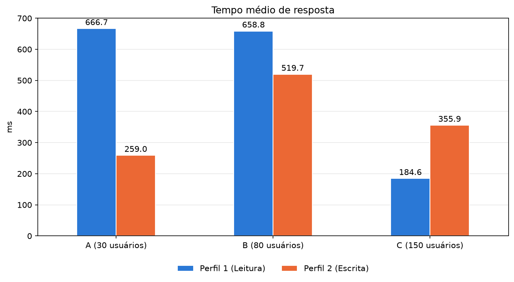
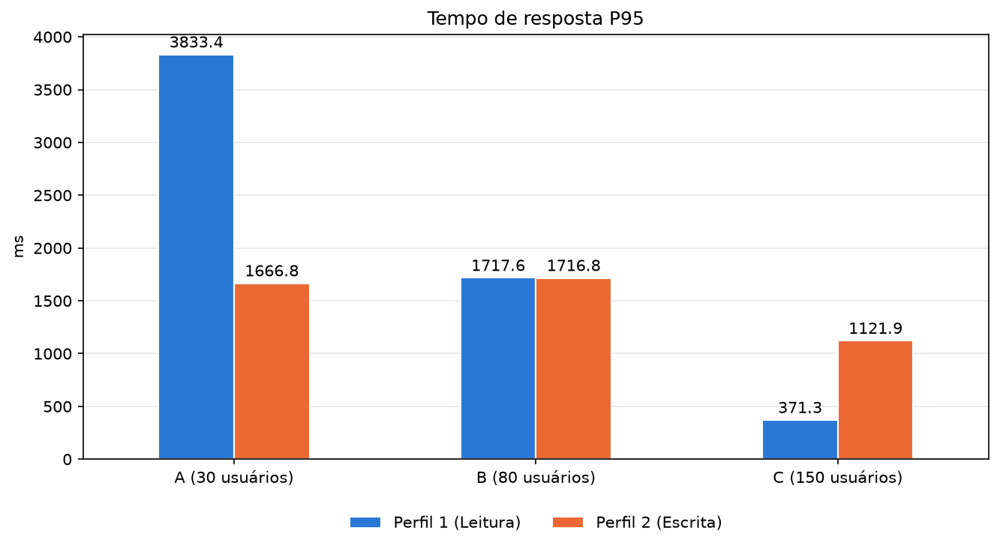
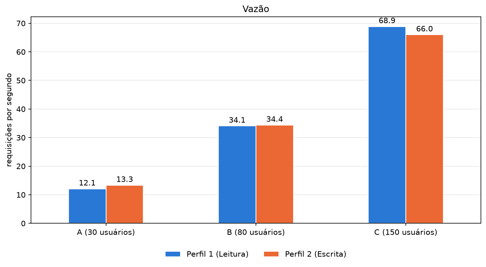
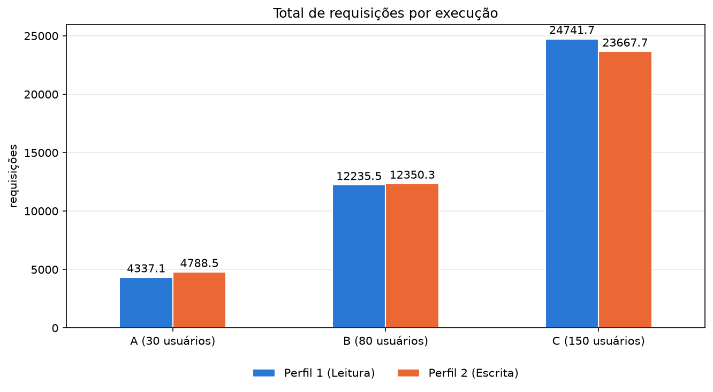
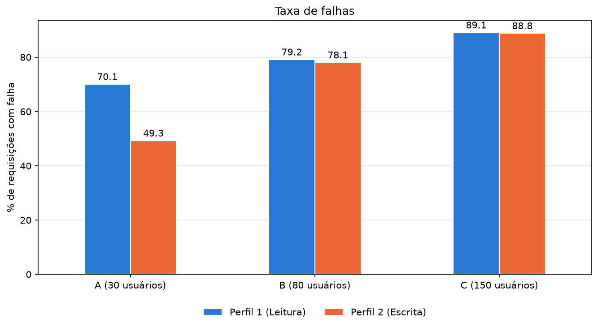
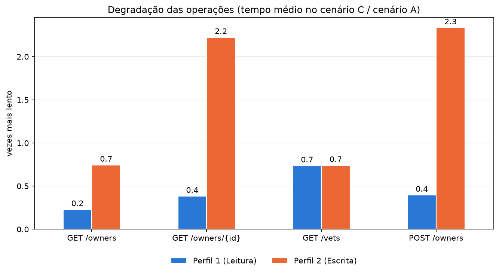
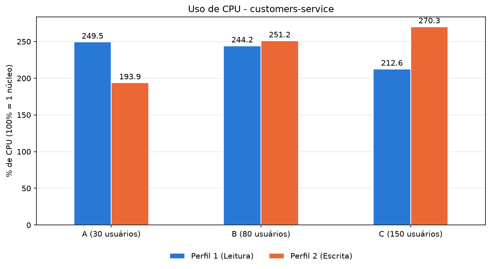
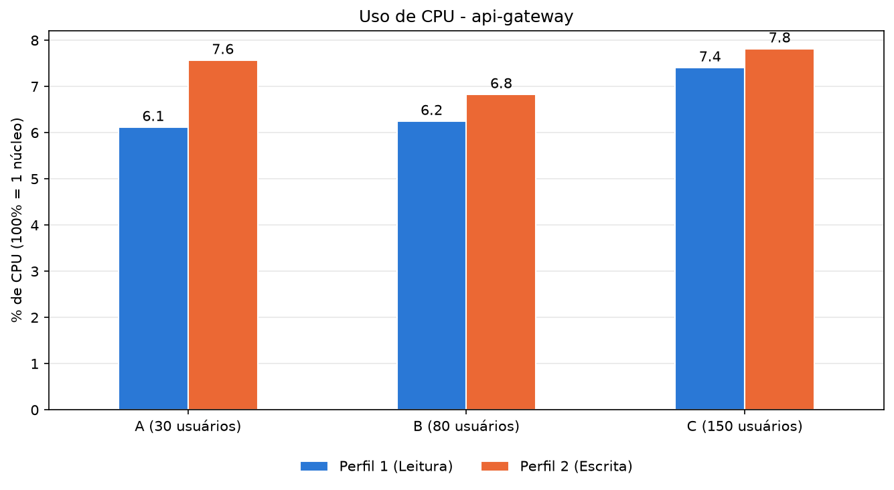
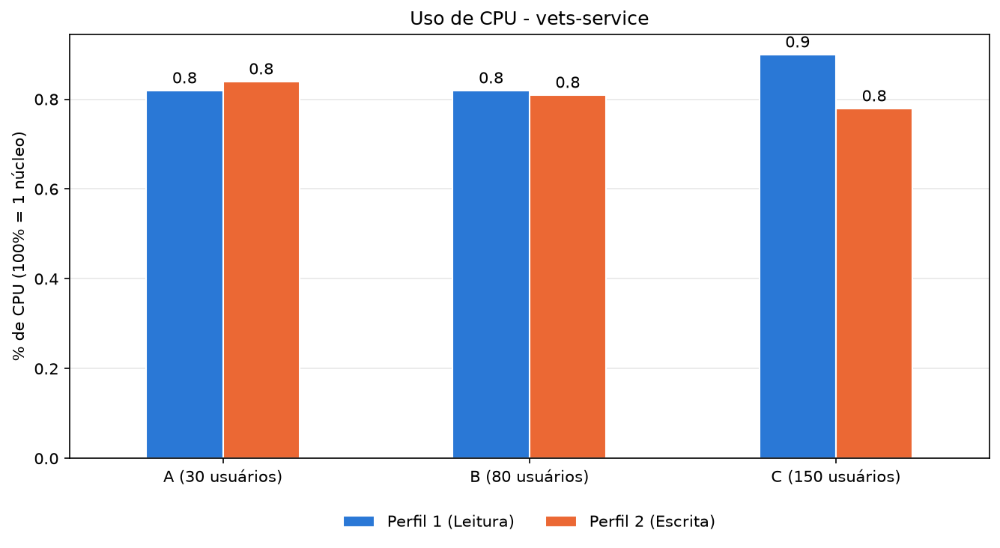

# Trabalho Prático 06: Avaliação de Desempenho de Microsserviços com Locust

**Disciplina:** Sistemas Distribuídos (UFPI) · **Aluno:** João Vitor

Avaliação de desempenho do [Spring PetClinic Microservices](https://github.com/spring-petclinic/spring-petclinic-microservices)
com o [Locust](https://locust.io), analisando o impacto da quantidade de usuários e do tipo de requisição
(perfil de leitura e perfil de escrita) sobre tempo de resposta, vazão, falhas e uso de CPU.

**Vídeo demonstrativo:** TODO: colar o link do vídeo (4 a 6 min)

---

## Sumário

1. [Estrutura do repositório](#1-estrutura-do-repositório)
2. [Ambiente](#2-ambiente)
3. [Aplicação e endpoints](#3-aplicação-e-endpoints)
4. [Como reproduzir](#4-como-reproduzir)
5. [Metodologia](#5-metodologia)
6. [Resultados](#6-resultados)
7. [Análise: respostas às questões](#7-análise-respostas-às-questões)
8. [Conclusões](#8-conclusões)

---

## 1. Estrutura do repositório

```
.
├── docker-compose.yml        # stack do PetClinic (imagens 3.4.1 fixadas)
├── app/                      # projeto Python (uv)
│   ├── locustfile.py         # os dois perfis de carga
│   ├── executar_testes.py    # executa as 60 execuções, mede a CPU e salva os CSVs
│   ├── gerar_graficos.py     # gera os gráficos a partir dos CSVs
│   └── pyproject.toml / uv.lock
├── results/
│   ├── resultados.csv        # uma linha por execução e operação
│   ├── cpu.csv               # CPU média de cada serviço em cada execução
│   ├── media.csv             # média das 10 repetições, por perfil, cenário e operação
│   ├── media_cpu.csv         # média das 10 repetições da CPU, por perfil, cenário e serviço
│   ├── locust/               # CSVs originais do Locust de cada execução
│   └── graficos/             # os 9 gráficos
└── docs/trabalho06.pdf       # enunciado
```

| Arquivo | Colunas |
|---|---|
| `resultados.csv` e `media.csv` | perfil, cenário, usuários, repetição (só no `resultados.csv`), operação (`Total` = todas), requisições, falhas, taxa de falhas (%), tempo médio (ms), P95 (ms), vazão (req/s) |
| `cpu.csv` e `media_cpu.csv` | perfil, cenário, usuários, repetição (só no `cpu.csv`), container, CPU (%) |
| `locust/<perfil>_<cenário>_repNN_*.csv` | `_stats` (estatísticas finais), `_stats_history` (série temporal), `_failures` e `_exceptions` (erros) |

## 2. Ambiente

Todos os experimentos rodaram em uma única máquina: o Locust gerando carga e os containers da aplicação
dividem os mesmos recursos.

| Item | Valor |
|---|---|
| CPU | AMD Ryzen 9 7950X (16 núcleos / 32 threads) |
| RAM | 32 GB (31,1 GiB utilizáveis) |
| Sistema operacional | Windows 11 Pro (build 26300) |
| Docker | Docker Desktop, Engine 29.8.2 (backend WSL 2); VM com 32 CPUs e 15,2 GiB |
| Aplicação | Spring PetClinic Microservices 3.4.1 (imagens `springcommunity/*:3.4.1`) |
| Gerador de carga | Locust 2.46.7, Faker 40.43, Python 3.12.13 |
| Análise | pandas 3.0.6, matplotlib 3.11.2 |

## 3. Aplicação e endpoints

A stack é o `docker-compose.yml` oficial do projeto (tag `v3.4.1`) com estas mudanças:

- imagens fixadas na tag `3.4.1` (a mesma do `latest` no Docker Hub, mas sem risco de mudar);
- serviços Java com `JAVA_TOOL_OPTIONS=-XX:MaxRAM=1g` e limite de memória de 512 MiB para **1 GiB**
  (ver [5.4](#54-teste-piloto-e-ajustes));
- `genai-service` removido: exige chave da OpenAI/Azure e não participa dos endpoints testados;
- healthchecks nos serviços de negócio e no gateway, para o `docker compose up --wait`;
- `admin-server`, Prometheus e Grafana no profile `monitoring`, opcionais (usados no vídeo, desligados durante as medições).

```
               ┌──────────────────────────┐
 Locust ──────▶│ api-gateway :8080        │── /api/customer/** ──▶ customers-service :8081 (HSQLDB em memória)
               │ (Spring Cloud Gateway +  │── /api/vet/**      ──▶ vets-service :8083      (HSQLDB, @Cacheable)
               │  CircuitBreaker + Retry) │
               └──────────────────────────┘
   config-server :8888 · discovery-server (Eureka) :8761 · visits-service :8082 · tracing-server (Zipkin) :9411
```

**Endpoints verificados na versão utilizada (3.4.1).** O enunciado usa caminhos lógicos; na aplicação,
todo o tráfego entra pelo api-gateway, que remove o prefixo (`StripPrefix=2`) e encaminha para o serviço:

| Operação (enunciado) | Requisição real (gateway) | Serviço / método | Resposta |
|---|---|---|---|
| GET /owners | `GET /api/customer/owners` | customers-service `OwnerResource.findAll()` | 200, lista de todos os owners |
| GET /owners/{id} | `GET /api/customer/owners/{id}` | customers-service `OwnerResource.findOwner()` | 200, um owner |
| GET /vets | `GET /api/vet/vets` | vets-service `VetResource.showResourcesVetList()` | 200, lista de veterinários (em cache) |
| POST /owners | `POST /api/customer/owners` | customers-service `OwnerResource.createOwner()` | 201, owner criado |

Detalhes da versão que importam para a análise:

- **`GET /owners` não tem paginação** e carrega os pets de cada owner com `FetchType.EAGER`. O custo cresce
  com o número de owners no banco, que aumenta a cada `POST /owners`.
- **`GET /vets` usa `@Cacheable`**: depois da primeira chamada, não consulta o banco.
- O gateway aplica um **circuit breaker** (Resilience4j) em todas as rotas, com limite de 10 s por requisição.
  Ele é **um só para todas as rotas** (`defaultCircuitBreaker`): quando mais da metade das últimas 100 chamadas
  falha, ele abre e o gateway passa a responder pelo fallback, sem chamar os serviços. Nos testes, o fallback
  respondeu **405** aos GET e **503** ao POST, e o Locust conta as duas respostas como falha.
- Todos os serviços exportam 100% dos traces para o Zipkin (`management.tracing.sampling.probability: 1`).

## 4. Como reproduzir

**Pré-requisitos:** Docker Desktop (ou Docker Engine + Compose v2), [uv](https://docs.astral.sh/uv/) e Git.

```bash
# 1. Instalar as dependências Python (com o Docker Desktop aberto)
cd app
uv sync

# 2. Bateria completa: 2 perfis x 3 cenários x 10 repetições = 60 execuções (~7 h)
#    O próprio script sobe a aplicação (docker compose down + up) antes da primeira execução.
uv run python executar_testes.py

# 3. Gerar os gráficos em results/graficos/
uv run python gerar_graficos.py
```

Os parâmetros (repetições, aquecimento, duração, cenários e serviços monitorados) ficam como constantes no
início de [`app/executar_testes.py`](app/executar_testes.py). Se a bateria for interrompida, ela recomeça do
zero na próxima chamada.

Para usar a interface web do Locust (como no vídeo), com a aplicação no ar:

```bash
docker compose up -d --wait
cd app
uv run locust -f locustfile.py PerfilLeitura --host http://127.0.0.1:8080   # abre em http://localhost:8089
```

Monitoramento opcional, usado no vídeo e desligado durante as medições:

```bash
docker compose --profile monitoring up -d --wait
```

| Ferramenta | Endereço | O que mostra |
|---|---|---|
| Grafana | http://localhost:3030/d/69JXeR0iw/spring-petclinic-metrics | dashboard "Spring Petclinic Metrics" (acesso anônimo) |
| Spring Boot Admin | http://localhost:9090 | JVM, CPU, memória e threads de cada serviço |
| Prometheus | http://localhost:9091 | métricas brutas coletadas do `/actuator/prometheus` |
| Zipkin | http://localhost:9411 | traces das requisições passando pelo gateway |
| Eureka | http://localhost:8761 | serviços registrados |

Antes de rodar a bateria, desligue o monitoramento com `docker compose --profile monitoring down`.

> **Use `127.0.0.1`, não `localhost`.** No Windows, `localhost` resolve primeiro para IPv6 (`::1`) e cada conexão
> nova feita pelo Python esperou de 10 a 20 s antes de cair para IPv4. Com `127.0.0.1` a mesma requisição leva ~20 ms.

## 5. Metodologia

### 5.1 Perfis de carga

Implementados em [`app/locustfile.py`](app/locustfile.py) como duas classes de usuário. Os pesos das tarefas
são exatamente as porcentagens do enunciado:

| Operação | Perfil 1 (Leitura), `PerfilLeitura` | Perfil 2 (Escrita), `PerfilEscrita` |
|---|---|---|
| GET /owners | 45% | 20% |
| GET /owners/{id} | 35% | 20% |
| GET /vets | 15% | 20% |
| POST /owners | 5% | 40% |

- Cada usuário espera de **1 a 3 s** (uniforme) entre requisições, simulando o tempo de reflexão de uma pessoa.
- `GET /owners/{id}` sorteia um id entre os 10 owners iniciais e os criados durante a execução.
- `POST /owners` gera nomes e cidades com o Faker (`pt_BR`) e um telefone de 10 dígitos, que respeita a
  validação `@Digits(integer = 12)`. Quando a resposta é 201, o id do owner criado entra na lista usada pelo
  `GET /owners/{id}`.

### 5.2 Cenários e execuções

| Cenário | Usuários | Aquecimento (descartado) | Medição | Taxa de criação de usuários |
|---|---|---|---|---|
| A (Leve) | 30 | 1 min | 6 min | 10 usuários/s |
| B (Moderado) | 80 | 1 min | 6 min | 10 usuários/s |
| C (Elevado) | 150 | 1 min | 6 min | 10 usuários/s |

2 perfis × 3 cenários × 10 repetições = **60 execuções** de 7 min cada, feitas por
[`app/executar_testes.py`](app/executar_testes.py).

- **Descarte do aquecimento:** o locustfile zera as estatísticas do Locust (`stats.reset_all()`) ao fim do
  1º minuto. O `_stats.csv` final de cada execução, inclusive a vazão, reflete só os 6 min de medição. Todos os
  usuários já estão ativos antes do fim do aquecimento (150 usuários a 10/s = 15 s).
- **Ordem intercalada:** repetição → perfil → cenário (rep 1: Leitura A, B, C, Escrita A, B, C; rep 2: ...).
- **Sem reinício entre execuções:** a aplicação é iniciada **uma única vez**, antes da primeira execução
  (`docker compose down` + `up --wait`). Em seguida, o script espera o gateway responder corretamente 5 vezes
  seguidas e faz 100 chamadas ao `GET /vets` para limpar a janela do circuit breaker (ver [5.4](#54-teste-piloto-e-ajustes)).
  As 59 execuções seguintes usam a mesma instância: os owners criados pelos POSTs **se acumulam** no banco em
  memória, e o estado do circuit breaker passa de uma execução para a seguinte. A escolha reduziu a bateria
  de ~8,5 h para ~7 h. O efeito disso nos resultados é analisado na [seção 6](#6-resultados).
- **CPU:** o `docker stats` amostra o api-gateway, o customers-service e o vets-service durante toda a
  execução (~1 amostra a cada 2 s por serviço); só as amostras após o aquecimento entram na média. A CPU é
  medida em % de **um** núcleo (200% = dois núcleos inteiros).

### 5.3 Métricas e agregação

| Métrica | Fonte (`_stats.csv` de cada execução) |
|---|---|
| Tempo médio de resposta (ms) | `Average Response Time` |
| Tempo de resposta P95 (ms) | coluna `95%` |
| Vazão (req/s) | `Requests/s` (requisições ÷ tempo de medição) |
| Total de requisições | `Request Count` |
| Taxa de falhas (%) | `Failure Count` ÷ `Request Count` × 100 |
| CPU (%) por serviço | média das amostras do `docker stats` após o aquecimento |

Para cada configuração (perfil × cenário), o `media.csv` e o `media_cpu.csv` trazem a **média das
10 repetições**. O P95 reportado é a média dos P95 de cada execução. As requisições que falharam entram em
todas as métricas, inclusive no tempo de resposta e na vazão, como o Locust as registra.

### 5.4 Teste piloto e ajustes

Antes da bateria, testes curtos revelaram três problemas no ambiente, todos corrigidos antes das medições:

1. **`localhost` no Windows.** Cada conexão nova do Python para `http://localhost:8080` levava de 10 a 20 s,
   porque o nome resolve primeiro para IPv6 (`::1`), que o Docker Desktop não atende nessa porta. Com
   `http://127.0.0.1:8080` a mesma requisição leva ~20 ms. Todos os testes usam `127.0.0.1`.
2. **OOM no api-gateway: a JVM não enxergava o limite do container.** Com o compose original, o gateway ficou
   no teto de 512 MiB desde o primeiro cenário e foi morto pelo kernel (`OOMKilled=true`) no cenário B
   (80 usuários). A JVM 17.0.16 das imagens não detecta o limite de memória no Docker Desktop/WSL 2
   (`-Xlog:os+container` mostra `controller memory is not enabled`) e se dimensiona pela RAM da VM inteira:
   heap máximo de 3,8 GiB num container de 512 MiB. A correção foi informar o limite à JVM com
   `-XX:MaxRAM=1g` (heap máximo de 256 MiB, 25% do limite, como num Linux nativo) e manter o limite em 1 GiB,
   para dar folga à memória fora do heap.
3. **Falhas da subida "contaminavam" o circuit breaker.** Enquanto a aplicação sobe, a checagem de prontidão
   gera falhas que ficam guardadas na janela de 100 chamadas do circuit breaker (o endpoint
   `/actuator/circuitbreakers` mostrou cerca de 25 falhas em 35 chamadas logo após a subida). Quando a carga
   começava, essas falhas antigas podiam abrir o circuito no primeiro segundo, gerando 100% de falhas sem relação
   com o teste. A correção foram as 100 chamadas ao `GET /vets` depois da prontidão, que empurram as falhas para
   fora da janela (o mesmo endpoint passou a mostrar 0 falhas em 100 chamadas).

## 6. Resultados

As 60 execuções foram concluídas e somaram **821.208 requisições, das quais 700.085 falharam (85,3%)**. Os
valores são a média das 10 repetições, só na janela de medição de 6 min.

> **Atenção ao ler os resultados.** Como a aplicação não foi reiniciada entre as execuções, os owners criados
> se acumularam no banco e, a partir da 2ª ou 3ª repetição, o circuit breaker passou a recusar a maior parte
> das requisições (seção 6.2). As respostas de erro do fallback são muito rápidas e entram nas médias de tempo
> e de vazão. Por isso, a seção 6.5 mostra também a repetição 1, a única em que nenhum cenário teve falhas.

### 6.1 Visão geral

| Perfil | Cenário | Tempo médio (ms) | P95 (ms) | Vazão (req/s) | Requisições por execução | Falhas (%) |
|---|---|---|---|---|---|---|
| Perfil 1 (Leitura) | A (30 usuários) | 666,7 | 3.833 | 12,07 | 4.337 | 70,1 |
| Perfil 1 (Leitura) | B (80 usuários) | 658,8 | 1.718 | 34,06 | 12.236 | 79,2 |
| Perfil 1 (Leitura) | C (150 usuários) | 184,6 | 371 | 68,88 | 24.742 | 89,1 |
| Perfil 2 (Escrita) | A (30 usuários) | 259,0 | 1.667 | 13,33 | 4.789 | 49,3 |
| Perfil 2 (Escrita) | B (80 usuários) | 519,7 | 1.717 | 34,38 | 12.350 | 78,1 |
| Perfil 2 (Escrita) | C (150 usuários) | 355,9 | 1.122 | 65,99 | 23.668 | 88,8 |











### 6.2 Falhas ao longo da bateria

Taxa de falhas (%) de cada execução, na ordem em que foram feitas:

| Repetição | Leitura A | Leitura B | Leitura C | Escrita A | Escrita B | Escrita C |
|---|---|---|---|---|---|---|
| 1 | 0,0 | 0,0 | 0,0 | 0,0 | 0,0 | 0,0 |
| 2 | 0,0 | 0,5 | 96,1 | 0,0 | 0,1 | 93,7 |
| 3 | 16,6 | 95,1 | 98,1 | 0,0 | 89,5 | 97,8 |
| 4 | 92,4 | 98,4 | 99,0 | 20,7 | 97,1 | 98,6 |
| 5 | 95,9 | 98,9 | 98,7 | 0,4 | 96,1 | 98,7 |
| 6 | 96,8 | 99,1 | 99,4 | 73,1 | 98,2 | 99,8 |
| 7 | 99,8 | 99,9 | 99,9 | 99,5 | 99,9 | 99,9 |
| 8 | 99,8 | 99,9 | 99,9 | 99,6 | 99,9 | 99,9 |
| 9 | 99,8 | 100,0 | 99,8 | 99,7 | 99,9 | 99,9 |
| 10 | 99,9 | 99,9 | 99,9 | 99,7 | 99,9 | 100,0 |

Tipos de falha, somando todas as execuções (arquivos `locust/*_failures.csv`):

| Operação | 405 (fallback) | 503 (fallback) | Outras |
|---|---|---|---|
| GET /owners | 230.593 | 0 | 0 |
| GET /owners/{id} | 193.044 | 0 | 21 (18 × 400, 3 × 500) |
| GET /vets | 119.456 | 0 | 0 |
| POST /owners | 0 | 156.971 | 0 |

Praticamente todas as falhas (99,997%) são respostas do fallback do circuit breaker do gateway, inclusive as
119.456 do `GET /vets`, que é atendido por outro serviço (o vets-service ficou abaixo de 1% de CPU).

### 6.3 Por operação

Média das 10 repetições ([`results/media.csv`](results/media.csv)):

| Perfil | Operação | Tempo médio A (ms) | Tempo médio B (ms) | Tempo médio C (ms) | Falhas A (%) | Falhas B (%) | Falhas C (%) |
|---|---|---|---|---|---|---|---|
| Leitura | GET /owners | 1.013,2 | 883,5 | 231,5 | 70,9 | 79,7 | 89,5 |
| Leitura | GET /owners/{id} | 527,4 | 645,7 | 201,8 | 70,3 | 79,2 | 89,3 |
| Leitura | GET /vets | 2,3 | 2,0 | 1,7 | 67,0 | 77,6 | 87,6 |
| Leitura | POST /owners | 470,8 | 664,4 | 186,2 | 70,4 | 79,1 | 89,2 |
| Escrita | GET /owners | 769,9 | 992,2 | 572,7 | 50,2 | 79,3 | 89,6 |
| Escrita | GET /owners/{id} | 178,1 | 534,6 | 395,9 | 49,6 | 78,2 | 89,0 |
| Escrita | GET /vets | 2,5 | 2,0 | 1,8 | 48,0 | 76,6 | 87,4 |
| Escrita | POST /owners | 173,6 | 532,3 | 405,4 | 49,3 | 78,2 | 89,1 |



*Tempo médio no cenário C dividido pelo tempo médio no cenário A. Valores abaixo de 1 significam que o
cenário C ficou mais rápido, o que aqui acontece porque ele teve mais respostas rápidas de erro.*

### 6.4 Uso de CPU

CPU média de cada serviço durante a medição, em % de **um** núcleo ([`results/media_cpu.csv`](results/media_cpu.csv)):

| Perfil | Cenário | api-gateway | customers-service | vets-service |
|---|---|---|---|---|
| Perfil 1 (Leitura) | A (30 usuários) | 6,1 | 249,5 | 0,8 |
| Perfil 1 (Leitura) | B (80 usuários) | 6,3 | 244,2 | 0,8 |
| Perfil 1 (Leitura) | C (150 usuários) | 7,4 | 212,6 | 0,9 |
| Perfil 2 (Escrita) | A (30 usuários) | 7,6 | 194,0 | 0,8 |
| Perfil 2 (Escrita) | B (80 usuários) | 6,8 | 251,2 | 0,8 |
| Perfil 2 (Escrita) | C (150 usuários) | 7,8 | 270,3 | 0,8 |







## 7. Análise: respostas às questões

**1. Como o aumento de usuários afeta o tempo de resposta?**

Nas médias das 10 repetições, o tempo de resposta **não acompanha** o número de usuários: no Perfil 1 ele vai
de 666,7 ms (A) para 184,6 ms (C), e no Perfil 2 de 259,0 ms para 519,7 ms e depois 355,9 ms. Isso não reflete a
aplicação, e sim a proporção de falhas: as respostas do fallback levam poucos milissegundos, e quanto mais
falhas um cenário tem, mais a média cai (o C, com ~89% de falhas, tem as menores médias).

Na repetição 1, em que não houve falhas, o efeito esperado aparece com clareza:

- **Perfil 1:** o tempo médio sobe de 9,6 para 19,6 e depois 32,3 ms, e o P95 de 26 para 58 e depois 92 ms.
  O crescimento vem quase todo do `GET /owners` (17,1 → 40,9 → 69,6 ms); as demais operações ficam estáveis.
- **Perfil 2:** sobe de 44,9 para 65,1 ms e salta para 1.991,2 ms no cenário C (P95 de 4,7 s). O `GET /owners`
  vai de 210,8 para 3.498,0 ms. Esse salto mistura dois efeitos: mais usuários e um banco maior, já que a
  Escrita C rodou depois de outras cinco execuções.

Ou seja, mais usuários aumentam o tempo de resposta, e o efeito é muito mais forte no perfil de escrita,
porque os POSTs aumentam a tabela que o `GET /owners` devolve inteira a cada chamada.

**2. Qual perfil apresenta maior vazão?**

Nas médias, os dois perfis ficaram muito próximos: 12,07 contra 13,33 req/s no A, 34,06 contra 34,38 no B e
68,88 contra 65,99 no C (Leitura contra Escrita). A vazão cresceu quase na proporção dos usuários, porque cada
usuário espera de 1 a 3 s entre requisições: pela lei de Little, a vazão é `N / (Z + R)`, com N usuários,
pausa média Z = 2 s e tempo de resposta R. Na repetição 1, o modelo explica os números: na Leitura C,
150 / (2 + 0,032) = 73,8 req/s previstos contra 73,4 medidos; na Escrita C, 150 / (2 + 1,991) = 37,6 previstos
contra 37,3 medidos.

Na repetição 1, sem falhas, o **Perfil 1 (Leitura) teve maior vazão** em todos os cenários: 14,9, 39,6 e
73,4 req/s, contra 14,6, 38,6 e 37,3 do Perfil 2. No cenário C, a vazão da escrita caiu à metade porque o tempo
de resposta (~2 s) ficou tão grande quanto a pausa dos usuários. Nas médias, a vazão inclui as requisições que
falharam; contando só as bem-sucedidas, ela fica entre 3,4 e 7,9 req/s em todas as configurações.

**3. Quais operações apresentam maior degradação?**

- **`GET /owners` é a origem da degradação.** Na repetição 1, ele foi a única operação que piorou no Perfil 1
  (17,1 → 69,6 ms, ×4,1) e, no Perfil 2, foi de 210,8 para 3.498,0 ms (×16,6). Como não tem paginação e
  carrega os pets em modo EAGER, o custo dele cresce com cada owner criado.
- **`GET /owners/{id}` e `POST /owners` degradam por contágio no Perfil 2.** São operações baratas (~2,5 ms
  no cenário A da repetição 1), mas chegaram a 2.116 e 2.182 ms no cenário C, porque dividem o
  customers-service e o pool de conexões do banco com o `GET /owners`, que segura cada conexão por mais tempo
  conforme a tabela cresce. Nas médias das 10 repetições, também são as que mais pioram do A para o C no
  Perfil 2 (×2,2 e ×2,3, gráfico de degradação).
- **`GET /vets` não degrada:** fica entre 1,7 e 4,5 ms em todos os casos, porque é atendido por outro serviço,
  com cache. Mesmo assim, ele **falha** na mesma proporção das outras operações (até 87,6%), porque o circuit
  breaker do gateway é compartilhado: a lentidão do customers-service derruba também a rota do vets-service.
- Nas médias das 10 repetições, os fatores abaixo de 1 (por exemplo, `GET /owners` com ×0,2 no Perfil 1) não
  indicam melhora: o cenário C teve mais falhas rápidas, que puxam a média para baixo.

**4. Como o consumo de CPU varia entre os cenários?**

- **O customers-service concentra o consumo.** Nas médias, ele fica entre 194 e 270% (2 a 2,7 núcleos) sem
  tendência clara entre os cenários, porque, com ~85% das requisições recusadas pelo gateway, quem chega ao
  serviço é uma parcela pequena, mas cada `GET /owners` sobre uma tabela enorme é muito caro.
- **Na repetição 1, a CPU cresce fortemente com os usuários:** de 15,8 para 85,1 e 265,2% no Perfil 1, e de
  77,2 para 332,5 e 924,8% no Perfil 2 (mais de 9 núcleos no cenário C). O Perfil 2 consome bem mais, por causa
  do custo crescente do `GET /owners`.
- **O api-gateway** fica em torno de 6 a 8% nas médias (5 a 34% na repetição 1). Responder pelo fallback é barato.
- **O vets-service** fica abaixo de 1% nas médias (até 3,5% na repetição 1), graças ao cache e às requisições
  barradas no gateway.

**5. Qual cenário apresenta maior taxa de falhas?**

O **cenário C**, nos dois perfis: 89,1% no Perfil 1 e 88,8% no Perfil 2, contra 79,2% e 78,1% no B e 70,1% e
49,3% no A. Mas a tabela da seção 6.2 mostra que as falhas não são causadas só pelo número de usuários:

- na **repetição 1, nenhum cenário falhou**;
- o C é o primeiro a falhar (já na repetição 2), seguido do B (repetição 3) e do A (repetições 3 e 4);
- a partir da **repetição 7, todos os cenários ficam acima de 99%**.

As falhas são respostas do fallback do circuit breaker (405 nos GET e 503 no POST). Com os owners acumulando
entre as execuções, o `GET /owners` fica lento a ponto de passar do limite de 10 s do gateway (no fim da
repetição 1 ele já levava 3,5 s em média na Escrita C). Quando mais da metade das últimas 100 chamadas falha, o
circuito abre e recusa todas as rotas. O C falha primeiro porque tem mais usuários fazendo `GET /owners` ao mesmo
tempo e porque, em cada repetição, roda depois do A e do B, com o banco ainda maior.

## 8. Conclusões

Os resultados indicam que o sistema opera de forma estável enquanto o volume de dados é pequeno. Na primeira
repetição, nenhum cenário teve falhas, e o perfil de leitura manteve tempos baixos mesmo com 150 usuários
(32,3 ms de média). No perfil de escrita, o cenário C já ultrapassa o ponto de operação estável, com cerca de
2 s de tempo médio e a vazão reduzida à metade. Com o acúmulo de dados ao longo da bateria, sem reinício entre as
execuções, todos os cenários passaram a falhar, e o cenário C, por ter mais usuários e rodar depois do A e do B
em cada repetição, apresentou a maior taxa de falhas.

O customers-service concentra o consumo de CPU, e as operações de listagem, busca e criação de owners são as
mais sensíveis à carga: o `GET /owners`, sem paginação, fica mais caro a cada owner criado e arrasta as demais
operações do serviço, enquanto o circuit breaker compartilhado do gateway estende as falhas até o `GET /vets`.
A maior vazão nominal foi obtida no cenário C (68,88 req/s na leitura e 65,99 req/s na escrita), mas não deve
ser considerada ganho de desempenho, pois foi acompanhada por cerca de 89% de falhas: contando só as requisições
bem-sucedidas, a vazão nesse cenário ficou em 7,9 e 4,4 req/s. Como próximo passo, seria recomendável
investigar os limites do pool de conexões do banco, os timeouts e o circuit breaker do gateway e os recursos do
customers-service, adicionar paginação ao `GET /owners` e repetir os testes reiniciando a aplicação entre as
execuções, para comparar a capacidade sustentável de requisições bem-sucedidas.